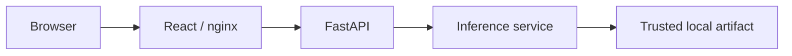
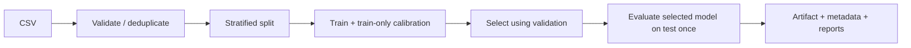

# Fake Review Detection & Review Authenticity Scoring

A supervised NLP project that estimates whether an English review resembles genuine
or deceptive examples. It includes reproducible ML training, calibrated probabilities,
held-out evaluation, versioned artifacts, a FastAPI service, and a one-page React UI.
There is no LLM API, RAG, authentication, database, or prediction history.

**A prediction is not proof of fraud.** The initial real model uses an English hotel
review research corpus, so its results do not establish reliability on general product
reviews or modern AI-written reviews. The synthetic demo only demonstrates the plumbing.

## Quick start — Windows with Docker Desktop

Open PowerShell in the repository root, with Docker Desktop running in Linux container mode:

```powershell
powershell -ExecutionPolicy Bypass -File scripts/start.ps1
```

The script builds the images, explicitly announces and trains a tiny demo baseline if
missing, then starts the two application services. Open **http://localhost:3000**.
API documentation is at **http://localhost:8000/docs**. No Python, Node, or Make installation
is needed for this path. The first image build needs internet access.

On macOS/Linux: `sh scripts/start.sh` or `make setup && make run`. On Linux, create writable
`artifacts/` and `reports/` directories for container UID 10001 before bootstrap if host
permissions prevent the trainer from writing. The application does not train at startup.

After bootstrap:

```powershell
docker compose up --build -d --wait
docker compose logs -f
docker compose down
```

The frontend proxies `/api/` to FastAPI; the browser never needs an internal Docker hostname.
Ports are bound to the local computer only. If startup fails, read `docker compose logs backend`.
A missing artifact error gives the exact training command. See [verification](docs/VERIFICATION.md)
for what has actually been exercised in this workspace.

## Train on real data

The optional importer downloads a checksum-pinned Kaggle mirror of the Cornell
Deceptive Opinion Spam Corpus. It does not silently download during application startup.
Read [dataset provenance and limitations](docs/DATASET.md) first.

With Docker only, download into the mounted raw-data directory explicitly:

```powershell
docker compose --profile tools run --rm -v "${PWD}/data/raw:/app/data/raw" trainer download-cornell
docker compose --profile tools run --rm trainer train-baseline --dataset data/raw/cornell.csv --version cornell-v1
```

If the dataset or artifact already exists, choose a new output/version or reuse it. Files
are never silently overwritten. Training produces actual reports under
`reports/baseline/cornell-v1/` and the selected model under `artifacts/baseline/cornell-v1/`.

Create `.env` from `.env.example` and set `MODEL_PATH=artifacts/baseline/cornell-v1`.
Then run `docker compose up -d --wait` to recreate the backend with the selected artifact.
The metadata determines its model name and version. Do not set a separate version that
could disagree with the loaded model. `.env` is ignored by Git.

For your own data, use a UTF-8 CSV with headers and quoted text where needed:

```csv
text,label
"The zip broke after two weeks, but support replaced it.",genuine
"An example review with a reliably established label.",deceptive
```

These two illustrative rows are not a training dataset. At least 10 **unique** examples
per class are required for pipeline operation; useful research needs much more. Labels
must be `genuine` or `deceptive`. Other columns are ignored by v1. Null/missing text,
empty text, unknown labels, malformed records, and contradictory labels are rejected.

## Architecture





One reusable Python package owns labels, preprocessing, training, metrics, and inference.
The API loads one artifact per process in its lifespan. Synchronous routes run in the
FastAPI thread pool. Baseline predictions share the fitted, read-only model; transformer
requests are serialized per worker to bound memory usage. Default: one Uvicorn worker,
no reload, bounded concurrency, no access logs. Each additional worker loads another copy
of the model, which is particularly expensive for DistilBERT.

## ML design and evaluation

* **TF-IDF + Logistic Regression:** a fast, interpretable sparse-text baseline.
* **TF-IDF + Multinomial Naive Bayes:** a useful comparison with different assumptions.
* Both use sigmoid calibration with three training-only stratified folds. The full
  preprocessing/vectorizer pipeline is inside each fold, preventing vocabulary leakage.
* Conservative NFKC/case/whitespace normalization retains negation, stop words, URLs,
  HTML, punctuation, and emoji. The tokenizer includes punctuation tokens; no aggressive
  removal rule is assumed to improve detection.
* Duplicate keys use the same normalization. Conflicting labels fail validation;
  consistent duplicates collapse before splitting. Near-duplicates and shared hotel or
  author identity are **not** removed. Review-level results are not unseen-hotel results.
* A fixed seed and sorted normalized text hashes create approximately 70/15/15
  train/validation/test splits. The vocabulary is fitted only on training rows.
* Default model selection uses validation **deceptive-class F1**. Ties favor Logistic
  Regression by fixed order. Only the winner is saved and evaluated on the test set.
  No refit on validation data occurs. The test set does not select hyperparameters.
* LR uses configurable balanced class weights; NB does not. No oversampling is applied.
  Both classes and their distributions remain represented in every split.
* Reports contain accuracy, precision, recall, F1, macro F1, Brier score, log loss,
  a classification report, and a confusion matrix PNG. Low Brier/log loss values indicate
  better probability predictions on that distribution, not universal reliability.

The central label mapping is **0 = deceptive, 1 = genuine**. Metrics deliberately treat
**deceptive as the positive class**: precision asks how often a deceptive flag is correct;
recall asks how many deceptive reviews were caught; F1 balances the two. A false positive
is a genuine review flagged deceptive; a false negative is a deceptive review called genuine.
Confusion-matrix rows are actual labels, columns predicted labels, both ordered
`[deceptive, genuine]`.

`authenticity_score = P(genuine) × 100`. The default decision is genuine if
`P(genuine) >= 0.5`; the artifact threshold or `PREDICTION_THRESHOLD` can change it.
`confidence` is the probability of the **chosen label**, not necessarily the larger
probability when the threshold differs from 0.5. Calibration does not guarantee truthful
probabilities under domain or class-prevalence shifts. Logistic Regression model signals
are signed TF-IDF × coefficient contributions to its **uncalibrated** linear score;
they are not causal explanations or definitive evidence of fraud.

An executed Cornell run and its limitations are recorded in [model card](docs/MODEL_CARD.md).
Synthetic demo metrics must never be used in a resume or represented as real accuracy.

## Local development and locked dependencies

Install Python 3.12, [uv](https://docs.astral.sh/uv/getting-started/installation/), and Node
22.12 or newer. `uv.lock` and `frontend/package-lock.json` pin resolved dependencies;
do not replace these with an untracked sequence of pip installs.

```powershell
uv sync --locked
uv run --locked reviews train-baseline --dataset data/demo/reviews.csv --version demo-v1 --demo
uv run --locked uvicorn review_authenticity.api:create_app --factory --reload --port 8000
# In a second terminal:
npm --prefix frontend ci
npm --prefix frontend run dev
```

Vite opens on http://localhost:5173 and proxies `/api`. `DEV_API_TARGET` changes its
backend target; `VITE_API_BASE_URL` is an optional build-time browser URL for separate
hosting. Docker uses relative URLs and nginx instead. Make equivalents are available.

```powershell
uv run --locked reviews download-cornell
uv run --locked reviews inspect-data --dataset data/raw/cornell.csv
uv run --locked reviews train-baseline --dataset data/raw/cornell.csv --version v2
uv run --locked reviews evaluate --artifact artifacts/baseline/v2
uv run --locked reviews compare artifacts/baseline/v2
```

`evaluate` exports the original stored test evaluation and figure; it deliberately does
not repeatedly query the held-out data. `compare` reports validation scores and batch
inference wall time per review, and refuses mismatched datasets or held-out splits.
Latency comparisons are meaningful only on the same hardware and comparable batching.
Use `--help` on every command. Change `configs/baseline.json` to configure ratios, seed,
features, regularization, calibration folds, threshold, and selection metric.

## Optional DistilBERT

Implemented separately, **not trained as part of this project's baseline verification**.
Its dependencies are locked as an optional extra and are excluded from the baseline image.

```powershell
uv run --locked --extra transformer reviews train-transformer --dataset data/raw/cornell.csv --version bert-v1 --epochs 2 --batch-size 8 --max-tokens 256
uv run --locked reviews compare artifacts/baseline/cornell-v1 artifacts/distilbert/bert-v1
```

The explicit command downloads `distilbert/distilbert-base-uncased`. Pass `--revision`
with a Hugging Face commit for reproducible pretrained weights. Training uses the HF
tokenizer on raw text, AdamW, gradient clipping, seed control, and validation-based epoch
selection. Fifteen percent of the training partition is reserved for temperature
calibration and excluded from gradient updates. The selected model is calibrated there
and evaluated once on test data. A positive scalar temperature rescales logits.

Serving uses `eval()`, inference mode without gradients, batches of at most eight, and
CUDA if available, otherwise CPU. Inputs are **truncated to max_tokens including special
tokens**, explicitly disclosed in model info and the UI. Neural training can differ
across devices despite seeding. Standard Compose does not expose a GPU; local Python
CUDA inference is available when a compatible CUDA-enabled PyTorch installation exists.

To serve via Docker, set `BACKEND_TARGET=transformer`, `MODEL_TYPE=distilbert`, and
`MODEL_PATH=artifacts/distilbert/bert-v1` in `.env`, then rebuild. The transformer image
is substantially larger. Never commit checkpoints to normal Git; regenerate them or
use a trusted artifact store/Git LFS when appropriate.

## API

* `GET /health` — API readiness and model-loaded status.
* `GET /api/v1/model/info` — name, version, demo flag, calibration, limits, threshold.
* `POST /api/v1/predict` — `{"text":"A review to analyze"}`.
* `POST /api/v1/predict/batch` — `{"reviews":["First review","Second review"]}`.

```powershell
Invoke-RestMethod http://localhost:8000/api/v1/predict -Method Post -ContentType 'application/json' -Body '{"text":"The room was quiet but the shower took a while to warm up."}'
```

Responses include `label`, both probabilities, `authenticity_score`, `confidence`, model
identity, `demo`, `threshold`, `inference_ms`, and optional `model_signals`. Batch latency
is the shared model-call duration, repeated per item; it excludes explanations and HTTP
overhead. Validation errors use 422, oversized bodies 413, unavailable models 503,
inference failures 500. No full review text is logged or echoed in validation errors.

## Configuration and artifacts

`.env.example` lists runtime options. Important values: `MODEL_PATH`, `MODEL_TYPE`,
`BACKEND_TARGET`, `WEB_CONCURRENCY`, `LOG_LEVEL`, `CORS_ORIGINS`, `MAX_REVIEW_LENGTH`,
`MAX_BATCH_SIZE`, `MAX_REQUEST_BYTES`, and `PREDICTION_THRESHOLD`. CORS origins are a JSON
array; wildcard origins are rejected in production. Baseline serving loads only a trusted
local joblib file, verifies its checksum, class mapping, schema, and scikit-learn version.
**A checksum is not a security sandbox:** never load an arbitrary downloaded/uploaded pickle.

Artifacts contain the selected model, metadata, dataset hash, statistics, configuration,
library versions, actual metrics, and a hashed split manifest. Publishing uses a staging
directory and refuses an existing version. Checkpoints and datasets are Git-ignored;
the included source and locks regenerate them. Model metadata—not directory naming—defines
whether an artifact is demo. Custom datasets require truthful provenance from their owner.

## Tests and code quality

```powershell
uv run --locked pytest
uv run --locked ruff check src tests
uv run --locked ruff format --check src tests
npm --prefix frontend ci
npm --prefix frontend run lint
npm --prefix frontend test
npm --prefix frontend run build
docker compose config --quiet
python scripts/smoke.py
```

Or `make test` and `make lint`. Tests cover CSV validation, duplicates, split isolation,
calibration/artifact round-tripping, probabilities, loading errors, API startup and input
limits, frontend loading/results/errors. Normal tests use a tiny synthetic baseline;
they do not download/train DistilBERT. Coverage reports important Python paths without a
100% target. Strict TypeScript and Ruff are used; mypy is omitted to avoid noisy stubs
for the scientific stack. CI performs these inexpensive checks on CPU.

The smoke script runs against an already-started application. It checks health, the
frontend's API proxy, single/batch predictions, invalid input, and eight concurrent requests.

## Repository map

```text
src/review_authenticity/   Shared ML package, CLI, inference, and API
configs/                  Reproducible training settings
tests/                    Python unit and integration tests
frontend/                 React/TypeScript/Vite, component tests, nginx
backend/Dockerfile        Baseline and optional transformer images
data/demo/                Clearly labeled synthetic fixtures
data/raw/                 Ignored imported datasets and provenance
artifacts/                Ignored immutable trained model versions
reports/                  Generated metrics, statistics, figures, comparisons
scripts/                  Windows and POSIX Docker bootstrap
docs/                     Architecture, dataset/model cards, interview guide
```

## Limits and future work

The corpus has source, era, language, and hotel-domain biases. "Genuine" labels are
assumptions about collected reviews, not forensic proof. A classifier can learn source
style, hotel names, or sentiment instead of deception. Sarcasm, very short reviews,
adversarial writing, new AI-generated styles, and prevalence shifts remain difficult.
This project does not perform moderation automatically.

Useful extensions include grouped hotel/author holdouts, near-duplicate detection,
external-domain testing, reliability plots and uncertainty intervals, multilingual
data, reviewer/rating/verified-purchase metadata, and drift monitoring. Public deployment
would need TLS and appropriate resource/rate controls at the hosting edge. Those are
outside this local portfolio application's scope.

Read [architecture](docs/ARCHITECTURE.md) and [interview guide](docs/INTERVIEW_GUIDE.md)
before describing the project in an interview.
